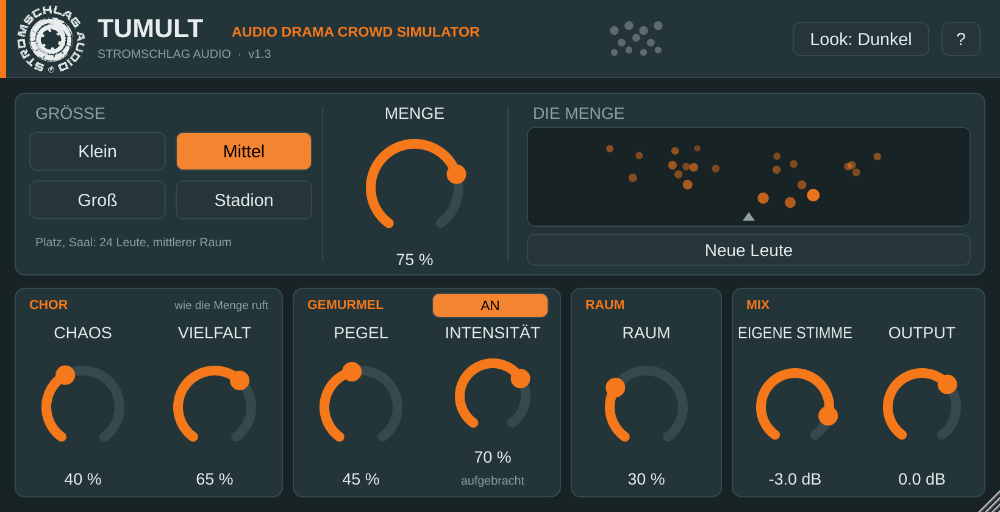
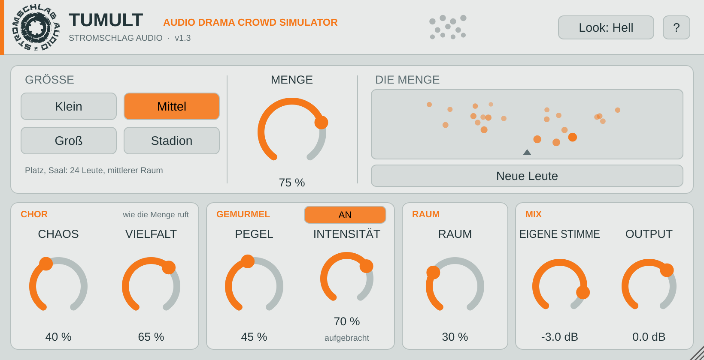

# TUMULT – Audio Drama Crowd Simulator

<picture>
  <source media="(prefers-color-scheme: dark)" srcset="docs/logo-dunkel.png">
  
</picture>

VST3-Effekt für Hörspiel-Produktion. TUMULT macht aus **einer einzigen** eingesprochenen Stimme eine Menschenmenge, die denselben
Text ruft, zum Beispiel einen Protest-Sprechchor. Du sprichst „Wir wollen keine Mauer!“ einmal ein, wählst Klein, Mittel, Groß
oder Stadion und hörst eine Menge, in der jeder ein bisschen früher oder später, höher oder tiefer, näher oder weiter weg ruft.
Darunter kann ein Gemurmel laufen, von leisem Raunen bis zur aufgebrachten Menge, das die Rufe in eine lebendige Szene einbettet.

**⬇ Download (Windows · VST3 · Stereo):** https://github.com/StromschlagProductions/Tumult-vst/releases/latest

## Warum es dieses Plugin gibt

In Hörspielen kommen immer wieder Szenen vor, in denen mehr als eine Stimme gebraucht wird: eine Demo, ein Sprechchor, ein
Stadion, ein Saal, der mitruft. Ich habe meistens nur meine eigene Aufnahme, und zehn Mal einsprechen und übereinanderlegen
klingt nach zehn Mal derselben Person. Ein Crowd-Plugin eines anderen Herstellers erfüllt seinen Zweck, aber mir fehlte eine
Menge, die ich mit wenigen Griffen einstellen kann und bei der ich beim Hören nicht ins Zweifeln komme, ob da wirklich Leute
stehen.

TUMULT löst das mit einer Menge aus vielen einzelnen Stimmen, die ich auf der Spur mit meinem Ruf einsetze. Jede Stimme hat
einen eigenen Einsatz, eine eigene Tonlage und Klangfarbe und einen eigenen Platz im Raum. Dazu kommt ein Gemurmel im Hintergrund, dessen Aufregung sich stufenlos einstellen lässt. Es gibt vier Größen und nur wenige
Regler. Die Anzeige zeigt die Menge von oben, jeder Punkt ist eine Stimme.

TUMULT ist ein Werkzeug für meinen eigenen Alltag in der Hörspielproduktion, entstanden aus dem, was ich in solchen Szenen
immer wieder gebraucht habe.

*TUMULT soll niemandem die Erfahrung abnehmen, eine Menge selbst zu inszenieren. Es kann viel Spaß machen und lehrreich sein,
Sprechchöre mit mehreren Aufnahmen, mit Freunden und mit eigener Staffelung aufzubauen und zu hören, wie Versatz, Tonlage,
Abstand und Raum ineinandergreifen. Ich bin dankbar, dass ich diesen Weg selbst gegangen bin – auch wenn er manchmal umständlich
war. TUMULT soll das Gestalten nicht ersetzen, sondern die technische Umsetzung im Alltag einfacher machen.*

– Lars Eickstädt, Stromschlag Audio

## Oberfläche

| Dunkel (Standard) | Hell |
|---|---|
|  |  |

Der Umschalter oben rechts wechselt den Look, die Wahl wird mit dem Projekt gespeichert. Der **?**-Knopf
öffnet die Hilfe, über jedem Regler erscheint beim Darüberfahren ein kurzer Hinweis.

Die Oberfläche lässt sich am rechten unteren Fensterrand stufenlos von 50 % bis 300 % vergrößern oder
verkleinern. Das Seitenverhältnis bleibt dabei fest.

## So ist es gedacht

- TUMULT kommt **direkt auf die Spur mit der eingesprochenen Stimme** (Mono oder Stereo). Es ersetzt den Eingang durch die
  Menge. Deine eigene Stimme steht als Regler daneben (EIGENE STIMME) und lässt sich leise unter die Menge legen oder ganz
  abschalten.
- **GRÖSSE** wählt, wie viele Leute da sind und wo: Klein, Mittel, Groß, Stadion. Mit der Größe ändern sich die Zahl der
  Stimmen, die Streuung des Einsatzes, die Breite im Stereobild, die Dumpfheit der hinteren Reihen und der Raum.
- **Staffelung:** Wenige Stimmen stehen vorne und sind deutlich, hell und nah am Einsatz. Die Masse dahinter ist dumpfer,
  leiser und breiter gestreut. So entsteht Tiefe, statt dass alle gleich weit weg sind.
- **Stabile Besetzung, wechselnde Rufe:** Position und Stimmcharakter bleiben bis **NEUE LEUTE** erhalten. In jeder Sprechpause (je nach CHAOS und Größe ab etwa einer halben bis einer Sekunde Stille) variieren Beteiligung, Einsatz und Ausdruck. Die Personen ziehen dabei nicht nach jedem Ruf an einen anderen Ort. **NEUE LEUTE** würfelt von Hand neu, ebenfalls in der nächsten Pause.
- **Fester Vorlauf von 500 ms:** TUMULT meldet ihn dem Host, der ihn ausgleicht. Dadurch darf ein Teil der Menge auch **vor** dem
  Einsatz deiner Stimme beginnen, so wie es in einer echten Menge ist, in der ein paar Leute früher anfangen. Mit CHAOS verteilt sich der Einsatz weit: manche rufen deutlich vor dir, andere erst eine Weile danach. Während aktiver Sprache entwickeln sich zusätzlich begrenzte individuelle Zeitversätze. Das ist keine unabhängige Time-Stretch- oder Formant-Engine.

- **Gemurmel im Hintergrund:** Unter den Rufen läuft ein Dauerbett aus Gemurmel in fünf Stufen (Raunen, Gemurmel, angespannt, aufgebracht, Tumult). **AN / AUS** aktiviert das Bett unabhängig von der Eingangsstimme, **PEGEL** regelt seine Lautstärke und bleibt beim Ausschalten erhalten. **INTENSITÄT** blendet stufenlos zwischen den Stufen. Zufällige Ausschnitte und Wechsel reduzieren feste Wiederholungen: Die fünf Stufen besitzen vier, vier, eine, drei und zwei Aufnahmen; links und rechts laufen unabhängig voneinander, immer wieder an anderer Stelle und weich überblendet. Es geht durch denselben Raum wie die Menge und läuft auch ohne Eingang, also auch allein als Hintergrundmenge (MENGE auf null, EIGENE STIMME aus).

## Größen

| GRÖSSE | Wann nehmen | Leute | Raum |
|---|---|---|---|
| Klein | Kneipe, Hinterhof, Treppenhaus | 10 | kurz und nah |
| Mittel | Marktplatz, Saal, Demo auf der Straße | 24 | mittlerer Raum |
| Groß | Halle, Sporthalle, große Versammlung | 40 | langer Raum, ein Echo von den Wänden |
| Stadion | Arena, Fußballstadion | 64 | langer Nachhall, zwei Echos von den Rängen |

Beim Umschalten gleiten die Stimmenpegel und Filter; zwei vorreservierte Räume überblenden mit erhaltener alter Hallfahne über etwa eine halbe Sekunde. Die Größe lässt sich automatisieren.

## Regler (alle automatisierbar)

**Oben**

| Regler | Wirkung |
|---|---|
| GRÖSSE | Klein, Mittel, Groß oder Stadion (siehe oben) |
| MENGE | Lautstärke der Menge. Sie ist so geeicht, dass die Menge bei etwa 70 % ungefähr so laut ist wie die eingesprochene Stimme, egal wie viele Leute es sind |
| Anzeige „DIE MENGE“ | Die Menge von oben: unten stehst du als Hörer, links/rechts ist das Stereobild, nach hinten wird es dumpfer und leiser. Jeder Punkt ist eine Stimme und leuchtet, wenn sie gerade ruft |
| NEUE LEUTE | würfelt die Menge in der nächsten Sprechpause neu |

**Unten, in vier Kästen**

| Kasten | Regler | Wirkung |
|---|---|---|
| **CHOR** | CHAOS | 0 % fast im Gleichschritt wie ein eingeübter Sprechchor, 100 % ein ungeordneter Haufen mit weit gestreutem Einsatz (im Stadion über eine Drittelsekunde) und unterschiedlichem Sprechtempo. Wie weit der Einsatz gestreut wird, hängt außerdem von der Größe ab |
| | VIELFALT | 0 % klingen alle ähnlich wie eine Gruppe, 100 % entstehen stärker unterschiedliche Tonlagen (bis etwa sechs Halbtöne) mit eigenen Klangfärbungen; Alter und Geschlecht werden nicht unabhängig modelliert |
| **GEMURMEL** | AN / AUS | Aktiviert das eigenständige Bett, auch auf einer leeren Spur ohne Aufnahme; automatisierbar und im Projekt gespeichert |
| | PEGEL | Lautstärke des Gemurmels im Hintergrund, ganz links aus |
| | INTENSITÄT | 0 % leises Raunen, in der Mitte angespannt, 100 % aufgebrachte Menge; die fünf Stufen blenden stufenlos ineinander, je aufgebrachter, desto etwas lauter |
| **RAUM** | RAUM | Wieviel Raum die Menge bekommt. Der Raum folgt der Größe. Er liegt auch auf der eigenen Stimme, damit sie in der Menge steht |
| **MIX** | EIGENE STIMME | dein eingesprochenes Original, in Stereo erhalten (mit 500 ms Vorlauf), ganz links aus |
| | OUTPUT | Gesamtpegel vor der Schutzsättigung am Ausgang; hohe Werte können den Klang verdichten |

**Presets** (erscheinen in der Preset-Liste des Hosts, setzen nur die Regler): Kneipe, Kleine Demo, Protestzug, Marktplatz,
Großdemo auf dem Platz, Sporthalle, Stadion-Chor, Stadion-Jubel und Ausgangslage. Die acht Szenen-Presets schalten auch das Gemurmel passend ein; Ausgangslage startet mit ausgeschaltetem Bett. Presets verändern OUTPUT nicht, damit dein eingestellter Gesamtpegel erhalten bleibt.

## Anwendung

**Protestzug:** Ruf einmal einsprechen („Wir wollen keine Mauer!“), TUMULT auf die Spur, Preset „Protestzug“. CHAOS etwas
niedriger, wenn die Leute geübt wirken sollen, höher für einen spontanen Haufen.

**Sprechchor im Stadion:** Preset „Stadion-Chor“, EIGENE STIMME leise lassen oder abschalten. Mit CHAOS steuerst du, wie
sauber der Chor im Takt ist.

**Saal, der mitruft:** Mittel oder Groß, VIELFALT hoch, CHAOS hoch, ein bisschen mehr RAUM.

**Kneipe, in der ein paar Leute zustimmend rufen:** Klein, MENGE etwas zurück, EIGENE STIMME als Hauptstimme dazu.

**Nur Gemurmel:** Eine leere Mono- oder Stereo-Audiospur anlegen, TUMULT als Insert einsetzen, MENGE auf null, EIGENE STIMME aus und GEMURMEL auf **AN**. PEGEL und INTENSITÄT nach Szene: leises Raunen vor der Kundgebung, angespannt beim Warten, aufgebracht kurz vor dem Ausbruch. Schalter, Pegel und Intensität lassen sich automatisieren. Die DAW muss das Plugin verarbeiten; das konkrete Stop-/Suspend-Verhalten hängt vom Host ab. TUMULT meldet bei aktiviertem Bett eine unbegrenzte Ausklingzeit.

**Mit echten Aufnahmen:** Eine echte Menge oder ein Atmo-Teppich darf leise darunter liegen. TUMULT liefert die Rufe auf den Punkt.

## Installation (Windows)

1. Über den Download-Link oben die ZIP-Datei `Tumult-v<Version>-Windows-VST3.zip` laden.
2. ZIP entpacken und den **ganzen Ordner** `Tumult.vst3` nach `C:\Program Files\Common Files\VST3` kopieren.
3. DAW neu starten bzw. Plugins neu scannen.

## Versionen

Die Versionsnummer steht in der Datei `VERSION`, im Plugin-Kopf und im Namen der Release. Sie wird bei jeder Änderung hochgezählt (1.0, 1.1, 1.2 …).

- **1.0** – Erste Version: der Stimmvervielfacher mit vier Größen, den Reglern MENGE, SYNCHRON, VIELFALT, RAUM, EIGENE STIMME und OUTPUT, einer Anzeige der Menge, NEUE LEUTE, acht Presets, Hell/Dunkel, skalierbarer Oberfläche und Hilfe. [Release-Hinweise](docs/releases/1.0.md).
- **1.1** – Der Regler SYNCHRON heißt jetzt CHAOS und ist umgekehrt (0 % im Gleichschritt, 100 % ungeordnet). Der Einsatz streut viel weiter (Vorlauf 500 ms statt 200 ms), jede Stimme hat ein eigenes Sprechtempo, VIELFALT reicht weiter. [Release-Hinweise](docs/releases/1.1.md).
- **1.3** – Eigenständiger GEMURMEL-Schalter, reparierte Werteingaben und Mono-Begrenzung, gespeicherte Besetzung, stabile Personen, aktive Sprachvariation, Stereo-Eigenstimme und überblendende Räume. [Release-Hinweise](docs/releases/1.3.md).
- **1.2** – Neu: das Gemurmel im Hintergrund mit den Reglern PEGEL und INTENSITÄT (fünf Stufen, stufenlos überblendet), die Presets stellen es mit ein. Die Oberfläche ist etwas breiter geworden. [Release-Hinweise](docs/releases/1.2.md).

## Aufbau

- `Source/TumultDSP.h`: Klang-Engine (reines C++ ohne JUCE)
- `Assets/murmur/`: die eingebetteten Gemurmel-Aufnahmen (Ogg Vorbis, mono)
- `Source/PluginProcessor.*`, `Source/PluginEditor.*`: JUCE-Plugin und Oberfläche
- `tools/render_demo.cpp`: rendert Hörbeispiele aus der echten Engine, mit Testsignal oder mit einer eigenen WAV-Aufnahme
- `.github/workflows/build.yml`: Windows-Bau mit Tests und Stabilitätstest (pluginval) bei jeder Änderung; Release nur mit ausdrücklichem publish-Auftrag (Workflow-Haken oder Release-Commit), siehe [docs/CI.md](docs/CI.md) und [docs/PUBLISHING.md](docs/PUBLISHING.md)

## Qualität und Prüfung

Die Engine ist getrennt von JUCE testbar. Der Windows-Workflow baut VST3 und führt DSP-/Prozessortests sowie **pluginval Strictness 8** aus. Linux prüft die DSP-Tests zusätzlich mit AddressSanitizer und UndefinedBehaviorSanitizer.

- Fester, dem Host gemeldeter Vorlauf von 500 ms; Eigenstimmen-Latenz ist bei 44,1 und 48 kHz getestet.
- Gleiche Eingabe, gleicher Startzustand und gleiche Parameter ergeben blockunabhängige Ergebnisse. Ein beliebiger Transportstart stellt keinen vollständigen DSP-Snapshot wieder her.
- Verarbeitung mit vorreservierten Puffern; Regressionstests überwachen C++-Allokationen im Audio-Callback.
- Mono wird vor der letzten Ausgangsbegrenzung summiert. Der Stereoanteil der Eigenstimme bleibt erhalten; die Crowd selbst verwendet die Mono-Summe des Eingangs.
- Pegel und Mischwerte werden geglättet. Personenmerkmale bleiben pro Besetzung stabil; Beteiligung und Einsatz variieren in ausreichend langen Pausen. NEUE LEUTE wählt eine gespeicherte neue Besetzung für die nächste Pause.
- Die Rufe stammen aus der Eingangsaufnahme. 14 eingebettete Mono-Gemurmeldateien von jeweils 30 Sekunden werden einmal dekodiert und geteilt. Zufällige Ausschnitte und weiche Wechsel reduzieren feste Loops; markante Ereignisse können wiedererkennbar bleiben.
- Eine leistungsbezogene Überblendung verbindet die fünf Gemurmelstufen. INTENSITÄT erhöht den Zielpegel zusätzlich um bis zu 3 dB.
- MENGE 70 % wurde anhand synthetischer Sprachsignale abgestimmt. Reale Lautheit und Sprachverständlichkeit hängen vom Eingang und von der Mischung ab.
- Die Ausgangsstufe sättigt oberhalb 0,8 (etwa −1,94 dBFS) weich. Sie ist kein True-Peak-Limiter.

Details, geprüfte Fehlerfälle und Grenzen: [Validierung 1.3](docs/VALIDATION-1.3.md).

Ob es echt klingt, entscheidet am Ende das Ohr. Rückmeldungen zum Klang sind deshalb besonders willkommen.

---

## Hinweis / Disclaimer

**Open Source · Work in Progress**

Dieses Plugin wurde in erster Linie für meinen persönlichen Workflow bei der Hörspielproduktion entwickelt. Es ist auf meine eigenen Anforderungen zugeschnitten und muss daher nicht für jeden Anwendungsfall geeignet sein.

Das Projekt wird laufend weiterentwickelt. Trotz sorgfältiger Tests können Fehler oder Kompatibilitätsprobleme auftreten. Die Software wird ohne Gewährleistung bereitgestellt; die Nutzung erfolgt auf eigene Verantwortung. Eine Haftung für mögliche Schäden oder Datenverluste wird, soweit gesetzlich zulässig, ausgeschlossen. Es gelten die jeweiligen Lizenzbedingungen.

**Feedback, Fehlermeldungen und Verbesserungsvorschläge sind herzlich willkommen!**

Wenn dieses kleine Werkzeug auch anderen die Hörspielarbeit erleichtert und mehr Raum für Geschichten und menschliche Kreativität schafft, freut mich das ganz besonders.

Öffentliches Versionsschema und Release-Ablauf: [Versionsnummern](docs/VERSIONING.md).
